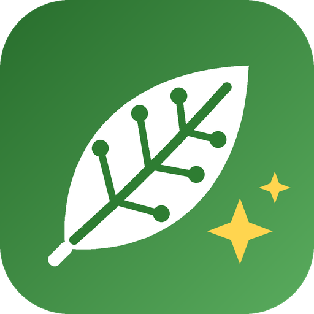

# ✨ Reto 11 – Integración con Inteligencia Artificial Generativa

> **Curso:** Desarrollo de Aplicaciones para Dispositivos Móviles · Universidad Nacional de Colombia
> **Autor y desarrollador:** Luis Alberto Castillo Sanabria
> **Plataforma:** Android (Kotlin) + Google Gemini + Flux (modelo libre)

App Android (Kotlin) que integra **inteligencia artificial generativa** en tres funciones, una en cada pestaña:

| 💬 Chatbot | 📝 Generación de texto | 🖼️ Generación de imágenes |
|---|---|---|
| Conversación con **Gemini**, que recuerda los mensajes anteriores. Tiene tres personalidades configurables. | Un **prompt predefinido** que se arma con lo que elige el usuario: tipo de texto, tono, extensión y tema. | Imágenes creadas a partir de una descripción y un estilo, con **Gemini** o con el **modelo libre Flux**. |

## Funcionalidades

- **Chatbot con memoria:** se envían a Gemini los últimos 20 mensajes, así que entiende preguntas de seguimiento ("¿cuál de esas ideas…?").
- **Personalidades** configurables mediante *system instruction*:
  - asistente general;
  - experto en agronomía y fitopatología;
  - tutor de Android con Kotlin.
- **Generador de texto** con opciones para elegir:
  - tipo: resumen, poema, correo, historia corta, explicación sencilla o lista de ideas;
  - tono: formal, amigable, divertido o académico;
  - extensión: corta, media o larga.

  El resultado se puede **copiar** o **compartir**.
- **Generador de imágenes** en cinco estilos: realista, dibujo animado, acuarela, pixel art o render 3D. La imagen se puede **guardar en la galería**.
  - Primero se intenta con el modelo de imágenes de **Gemini**.
  - Si la llave no tiene cuota para imágenes (el nivel gratuito no la incluye), **Gemini mejora la descripción** convirtiéndola en un prompt detallado en inglés, y el **modelo libre Flux** (vía Pollinations.ai) crea la imagen.
- **Ícono propio:** una hoja cuyas nervaduras terminan en nodos de circuito (la IA "dentro" de la planta) y destellos dorados de IA generativa. Es un ícono adaptativo, con versión de un color para los íconos temáticos de Android 13 o superior.
- **Formato Markdown** en las respuestas: negritas, cursivas, listas y títulos.
- **Errores explicados en español:** llave inválida, cuota agotada, modelo no disponible o sin conexión. Si el servidor está ocupado (500/503), la app **reintenta sola**.
- **Pantalla de Ajustes:** llave de API, modelos de Gemini y personalidad del chatbot.
- **La conversación no se pierde** al girar el teléfono ni al cambiar de pestaña (ViewModel).

## 🎬 Video demostrativo

Recorrido completo de la app (3 min 57 s) grabado en un Samsung Galaxy A03s, con respuestas reales de la IA: chatbot con memoria, generación de texto, generación de imágenes y cambio de personalidad del chatbot. Los tramos de espera aparecen acelerados y lo indica una etiqueta "▶▶ x2 / x3".

<a href="video/demo_reto11.mp4">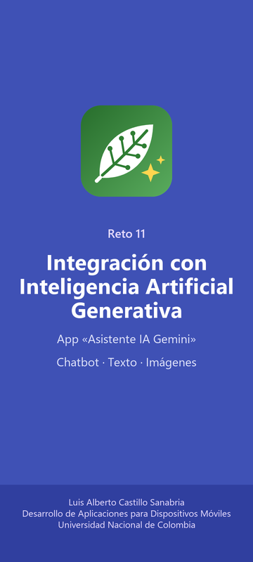</a>

▶️ **[Ver el video (MP4)](video/demo_reto11.mp4)**

## Capturas de pantalla

Tomadas en un Samsung Galaxy A03s (Android 13) con respuestas reales de la IA.

| Chat: inicio | Chat: respuesta | Chat: recuerda la conversación |
|:---:|:---:|:---:|
| 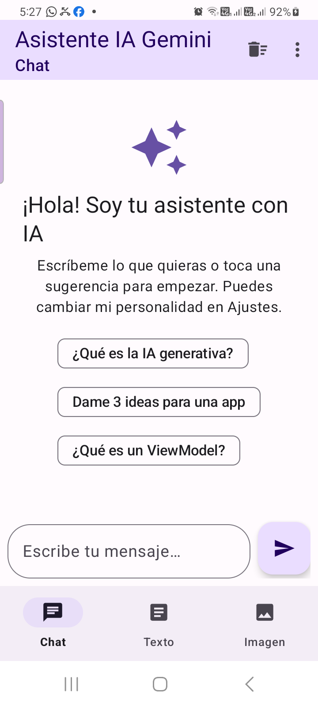 | 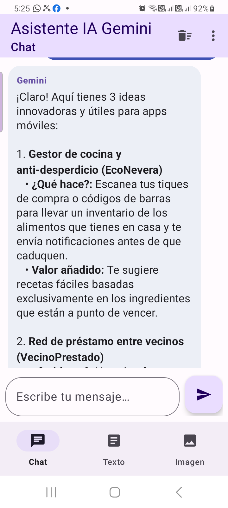 | 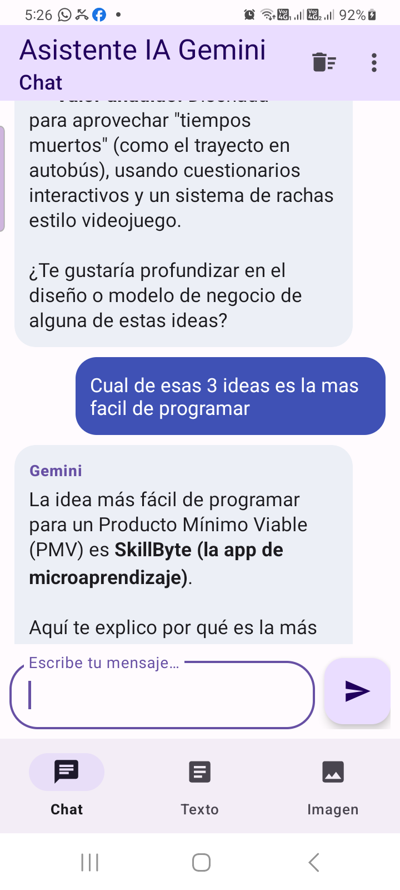 |

| Texto: formulario | Texto: poema generado | Imagen: generando |
|:---:|:---:|:---:|
| 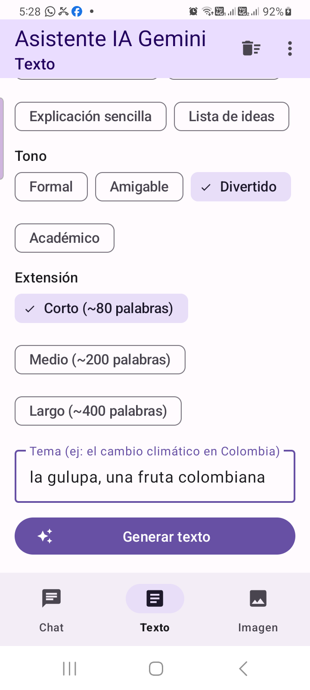 | 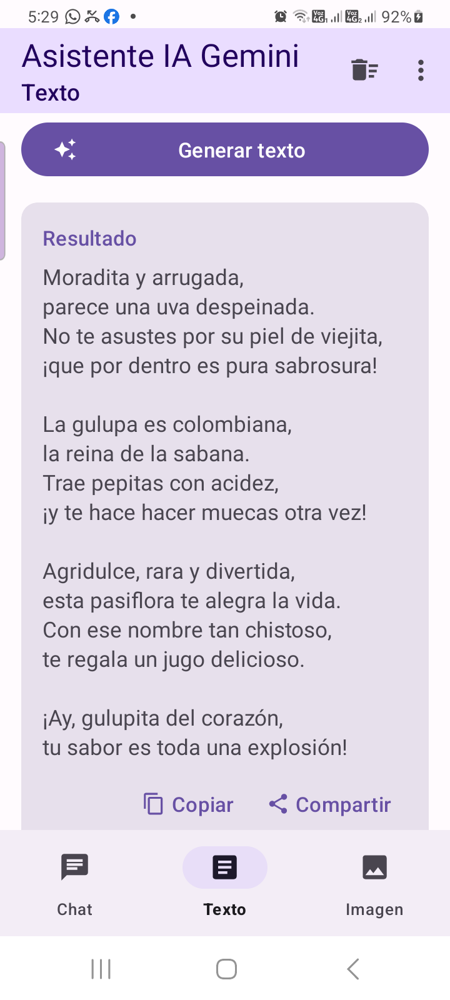 | 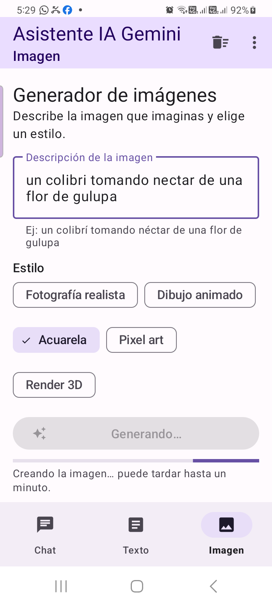 |

| Imagen generada | Prompt mejorado y guardado | Ajustes |
|:---:|:---:|:---:|
| 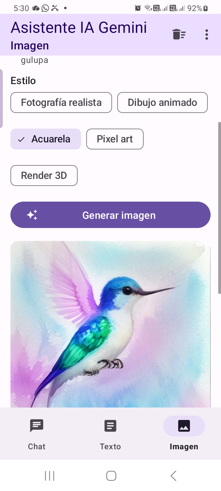 | 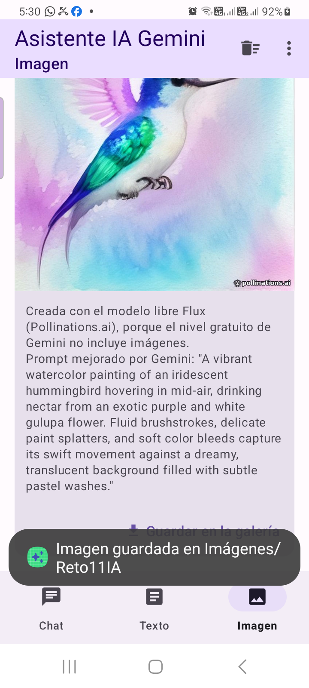 | 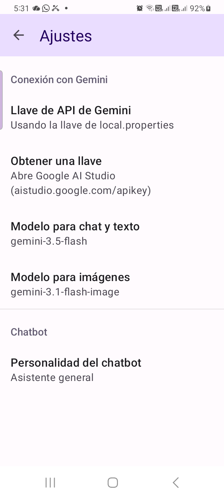 |

| Menú | Personalidad del chatbot | Chat como experto en agronomía |
|:---:|:---:|:---:|
| 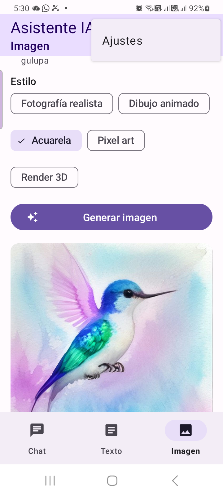 | 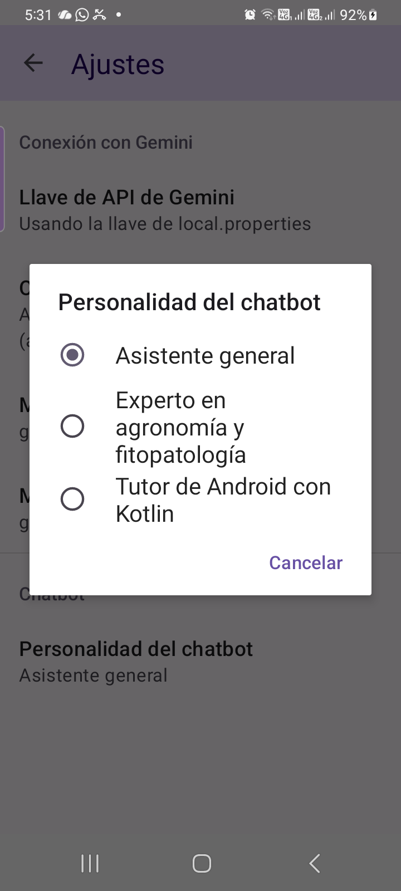 | 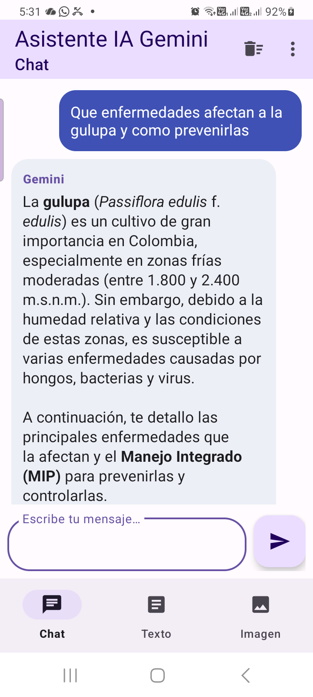 |

## Documentación

📘 **[Manual de usuario y técnico](docs/MANUAL.md)**

## Estructura del código

| Archivo | Descripción |
|---|---|
| `app/src/main/java/co/edu/unal/reto11ia/GeminiClient.kt` | Llamadas a la API REST de Gemini: chat, texto e imagen; manejo de errores y reintentos |
| `app/src/main/java/co/edu/unal/reto11ia/FreeImageClient.kt` | Generación de imágenes con el modelo libre Flux (Pollinations.ai) |
| `app/src/main/java/co/edu/unal/reto11ia/ViewModels.kt` | Estado y lógica de las tres pantallas (`ChatViewModel`, `TextViewModel`, `ImageViewModel`) |
| `app/src/main/java/co/edu/unal/reto11ia/MainActivity.kt` | Barra superior, menú y navegación entre las tres pestañas |
| `app/src/main/java/co/edu/unal/reto11ia/ChatFragment.kt` · `ChatAdapter.kt` | Pantalla del chatbot y burbujas de mensajes |
| `app/src/main/java/co/edu/unal/reto11ia/TextFragment.kt` | Pantalla del generador de texto (prompt predefinido) |
| `app/src/main/java/co/edu/unal/reto11ia/ImageFragment.kt` | Pantalla del generador de imágenes y guardado en la galería |
| `app/src/main/java/co/edu/unal/reto11ia/SettingsActivity.kt` · `AppSettings.kt` | Ajustes y lectura de la configuración |
| `app/src/main/java/co/edu/unal/reto11ia/Markdown.kt` | Conversión sencilla de Markdown a texto con formato |

## Tecnologías

- Kotlin · Android SDK (minSdk 24) · Material 3
- [Gemini API](https://ai.google.dev/) (Google AI Studio): `gemini-3.5-flash` para chat y texto, `gemini-3.1-flash-image` para imágenes
- [Pollinations.ai](https://pollinations.ai/): modelo libre **Flux** para imágenes
- AndroidX: Fragment, ViewModel, Lifecycle (corrutinas y StateFlow), RecyclerView y Preference
- `HttpURLConnection` + `org.json`, sin SDKs externos

## Cómo ejecutarlo

1. Crear una llave gratuita en **https://aistudio.google.com/apikey**.
2. Agregarla al archivo `local.properties` del proyecto. Este archivo **no se sube a GitHub**:
   ```properties
   GEMINI_API_KEY=tu_llave_aqui
   ```
   También se puede pegar después en la app: **⋮ → Ajustes → Llave de API de Gemini**.
3. Abrir el proyecto en Android Studio y ejecutarlo en un dispositivo o emulador con Internet.

## Autoría

Desarrollado por **Luis Alberto Castillo Sanabria** ([@LCastillo9806](https://github.com/LCastillo9806)) para el curso *Desarrollo de Aplicaciones para Dispositivos Móviles* de la **Universidad Nacional de Colombia**.
