# ✨ Manual de Usuario y Técnico — Reto 11: Integración con IA Generativa

> **Curso:** Desarrollo de Aplicaciones para Dispositivos Móviles
> **Autor y desarrollador:** Luis Alberto Castillo Sanabria
> **Institución:** Universidad Nacional de Colombia
> **Plataforma:** Android · Kotlin · Google Gemini API · Flux (Pollinations.ai)

---

## 📑 Tabla de contenidos

1. [Propósito](#1-propósito)
2. [Autoría](#2-autoría)
3. [Manual de uso](#3-manual-de-uso)
   - [3.1 Pantalla principal](#31-pantalla-principal)
   - [3.2 Chatbot](#32-chatbot)
   - [3.3 Generador de texto](#33-generador-de-texto)
   - [3.4 Generador de imágenes](#34-generador-de-imágenes)
   - [3.5 Ajustes y personalidad del chatbot](#35-ajustes-y-personalidad-del-chatbot)
   - [3.6 Mensajes de error](#36-mensajes-de-error)
4. [Cómo funciona](#4-cómo-funciona)
5. [Arquitectura y código](#5-arquitectura-y-código)
6. [Compilación y ejecución](#6-compilación-y-ejecución)

---

## 1. Propósito

Integrar un **modelo de inteligencia artificial generativa** en una app Android. El reto permite elegir entre chatbot, generación de texto o generación de imágenes; esta app implementa **las tres**, una por pestaña:

| Función | Modelo |
|:---|:---|
| 💬 Chatbot con memoria | Google **Gemini** (`gemini-3.5-flash`) |
| 📝 Generación de texto con prompt predefinido | Google **Gemini** (`gemini-3.5-flash`) |
| 🖼️ Generación de imágenes | **Gemini** (`gemini-3.1-flash-image`), o el modelo libre **Flux** cuando la llave no tiene cuota para imágenes |

## 2. Autoría

| Integrante | Rol |
|:---|:---|
| **Luis Alberto Castillo Sanabria** | Autor y desarrollador |

Curso *Desarrollo de Aplicaciones para Dispositivos Móviles* — **Universidad Nacional de Colombia**.
Repositorio: <https://github.com/LCastillo9806/Reto11IA>

Las capturas se tomaron en un **Samsung Galaxy A03s (Android 13)** con respuestas reales de la IA.

## 3. Manual de uso

### 3.1 Pantalla principal

La app tiene tres partes:

- **Barra superior:** muestra el nombre de la app y la pestaña actual. El botón 🗑️ limpia la pantalla actual (en el chat, empieza una conversación nueva) y el menú **⋮** abre **Ajustes**.
- **Contenido** de la pestaña elegida.
- **Barra inferior** con las tres pestañas: **Chat**, **Texto** e **Imagen**.

Al cambiar de pestaña o girar el teléfono, **no se pierde** lo que había en cada una.

| Menú ⋮ |
|:---:|
| 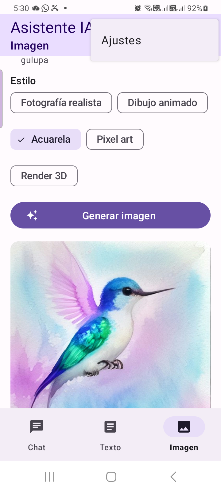 |

### 3.2 Chatbot

1. Escribe un mensaje y pulsa **➤**, o toca una de las **sugerencias**.
2. Mientras Gemini piensa, aparece *"Gemini está escribiendo…"* con una barra de carga.
3. La respuesta llega en una burbuja a la izquierda, con **negritas**, *cursivas* y listas.
4. Puedes hacer **preguntas de seguimiento**: el chatbot **recuerda** la conversación. En la tercera captura se le pregunta "¿Cuál de esas 3 ideas es la más fácil de programar?" y responde según las ideas que dio antes.

| Inicio con sugerencias | Respuesta de Gemini | Pregunta de seguimiento |
|:---:|:---:|:---:|
| 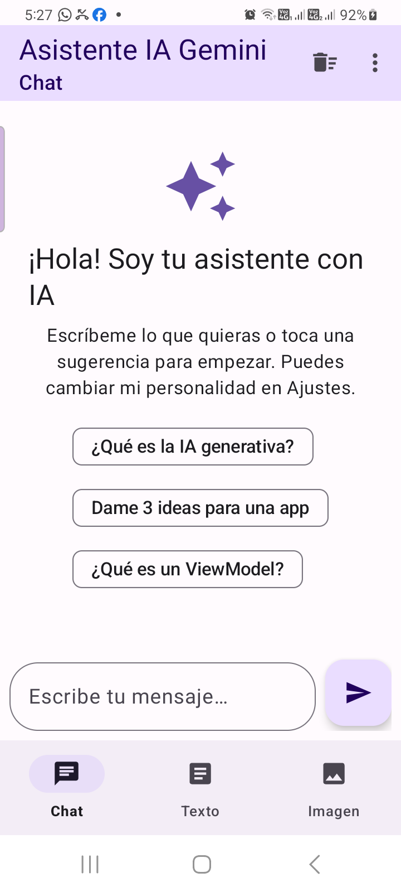 | 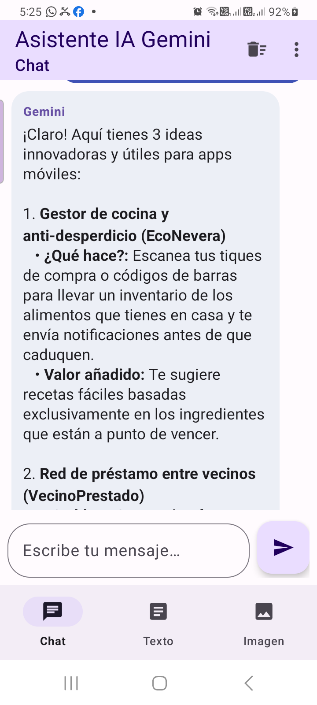 | 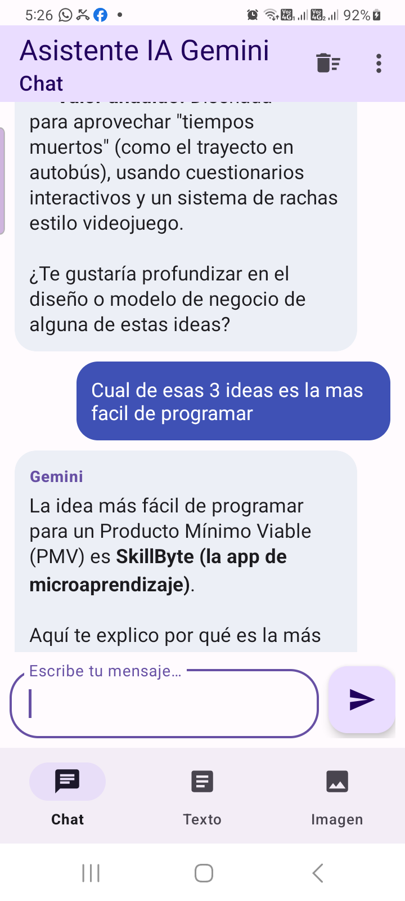 |

### 3.3 Generador de texto

1. Elige el **tipo de texto**: resumen, poema, correo electrónico, historia corta, explicación sencilla o lista de ideas.
2. Elige el **tono**: formal, amigable, divertido o académico.
3. Elige la **extensión**: corta (unas 80 palabras), media (unas 200) o larga (unas 400).
4. Escribe el **tema** y pulsa **Generar texto**.
5. El resultado se puede **copiar** o **compartir** con otras apps, como WhatsApp o el correo.

| Formulario (poema · divertido · corto) | Poema generado sobre la gulupa |
|:---:|:---:|
| 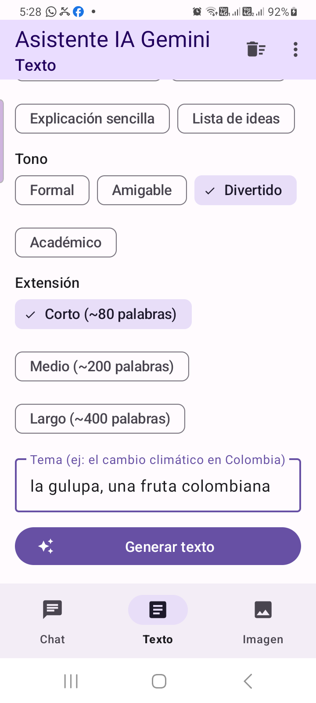 | 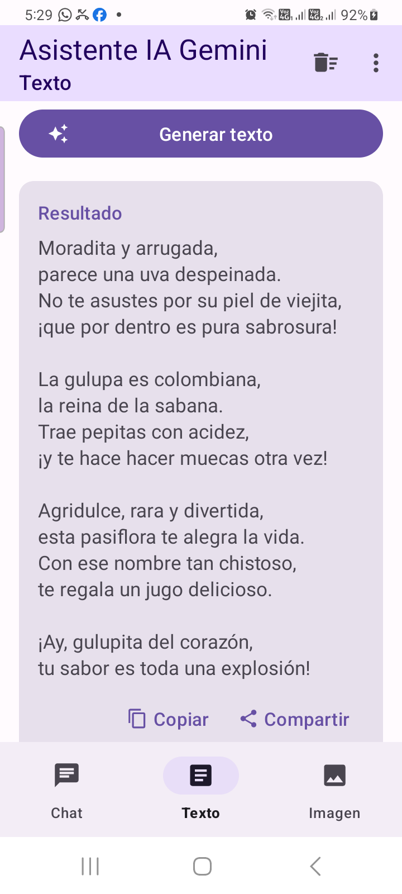 |

### 3.4 Generador de imágenes

1. Escribe una **descripción** de la imagen.
2. Elige un **estilo**: fotografía realista, dibujo animado, acuarela, pixel art o render 3D.
3. Pulsa **Generar imagen**. Puede tardar entre 10 y 60 segundos.
4. Debajo de la imagen se indica **qué modelo la creó** y, si se usó Flux, el **prompt mejorado por Gemini**.
5. Pulsa **Guardar en la galería** para guardarla en *Imágenes/Reto11IA*.

| Generando | Imagen generada (acuarela) | Prompt mejorado y guardado |
|:---:|:---:|:---:|
| 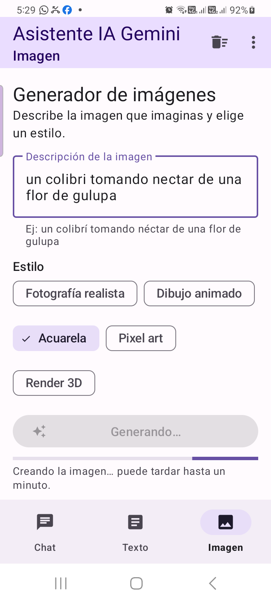 | 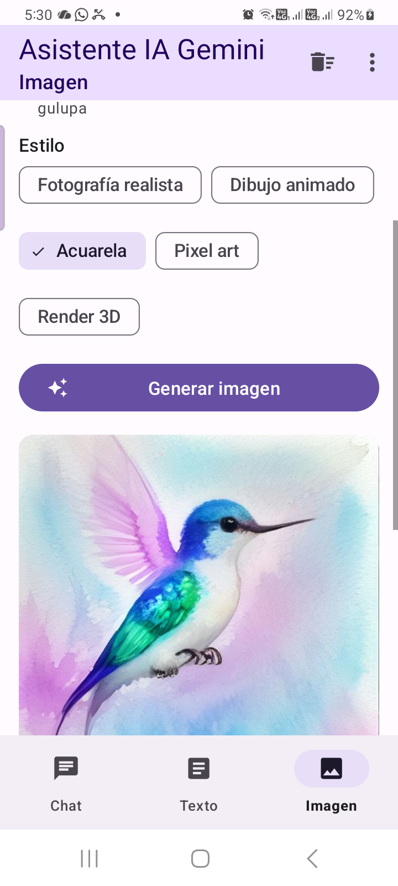 | 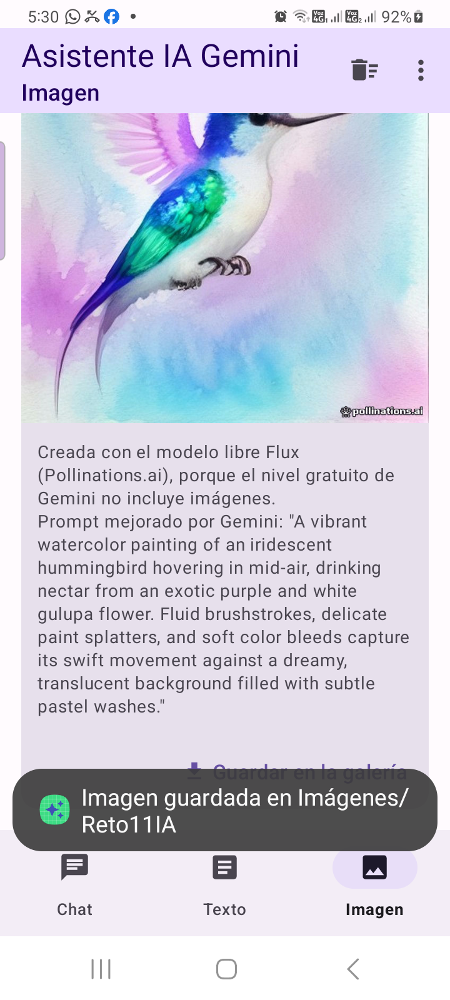 |

### 3.5 Ajustes y personalidad del chatbot

Desde **⋮ → Ajustes** se puede configurar:

| Ajuste | Para qué sirve |
|:---|:---|
| **Llave de API de Gemini** | Pegar una llave sin recompilar. Si se deja vacía, se usa la de `local.properties`. Nunca se muestra completa. |
| **Obtener una llave** | Abre Google AI Studio para crear una llave. |
| **Modelo para chat y texto** | Por defecto `gemini-3.5-flash`. Se puede cambiar si Google publica modelos nuevos. |
| **Modelo para imágenes** | Por defecto `gemini-3.1-flash-image`. |
| **Personalidad del chatbot** | Asistente general, experto en agronomía y fitopatología, o tutor de Android con Kotlin. |

La personalidad cambia la forma de responder. En la última captura, como **experto en agronomía**, el chatbot explica las enfermedades de la gulupa con su nombre científico y recomienda el Manejo Integrado de Plagas (MIP).

| Ajustes | Personalidad | Chat como experto en agronomía |
|:---:|:---:|:---:|
| 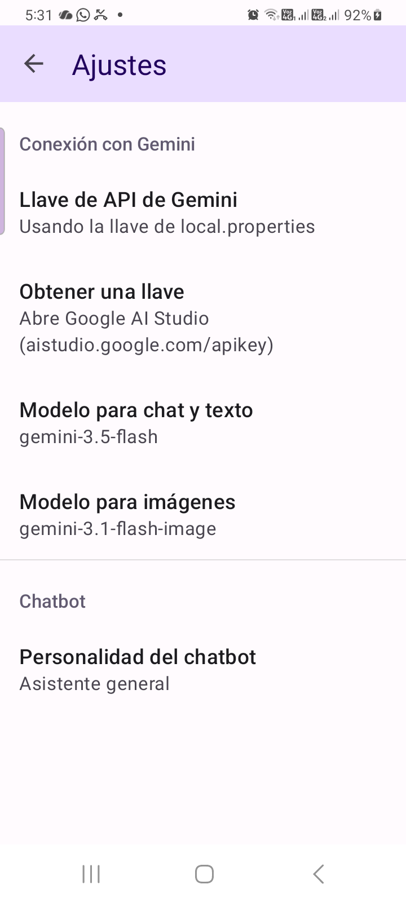 | 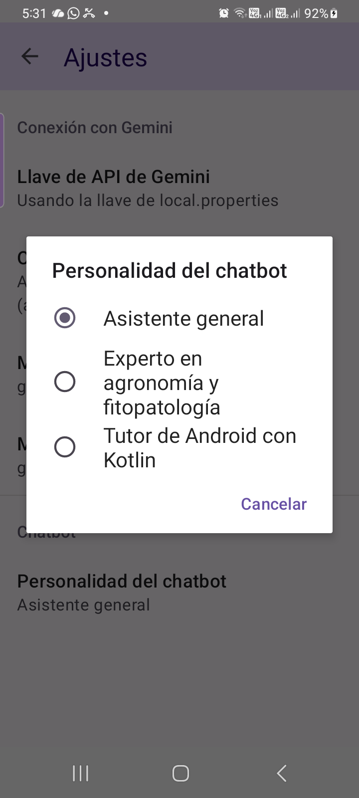 | 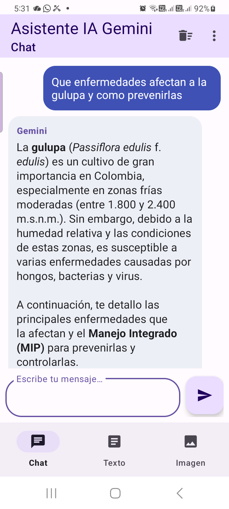 |

### 3.6 Mensajes de error

La app nunca se cierra por un error: muestra un mensaje en español (en el chat, como una burbuja roja ⚠️).

| Situación | Mensaje |
|:---|:---|
| No hay llave configurada | *"Falta la llave de API de Gemini…"* |
| Llave inválida | *"La llave de API no es válida. Revísala en Ajustes."* |
| Modelo inexistente | *"El modelo "…" no existe o no está disponible para tu llave. Cámbialo en Ajustes."* |
| Cuota agotada (429) | *"Se alcanzó el límite de uso de Gemini…"* |
| Servidor ocupado (500/503) | La app reintenta sola 2 veces; si sigue fallando, lo avisa. |
| Sin Internet | *"No hay conexión a internet o el servidor no respondió."* |

## 4. Cómo funciona

### 4.1 La API de Gemini

Las tres funciones usan el mismo servicio REST de Google AI Studio:

```
POST https://generativelanguage.googleapis.com/v1beta/models/{modelo}:generateContent
Cabecera: x-goog-api-key: <LLAVE>
```

Lo que cambia es el JSON que se envía:

| Función | Cuerpo de la petición |
|:---|:---|
| **Chat** | `contents` con el historial (`role: user` / `role: model`) + `systemInstruction` con la personalidad |
| **Texto** | `contents` con un solo mensaje: el prompt predefinido ya completado + `temperature: 0.9` |
| **Imagen** | `contents` con el prompt + `generationConfig.responseModalities = ["TEXT", "IMAGE"]` |

La respuesta trae `candidates[0].content.parts`: fragmentos de texto, o la imagen en Base64 (`inlineData`).

### 4.2 Memoria del chatbot

Gemini no guarda la conversación: cada petición es independiente. Para que "recuerde", la app **envía el historial** en cada mensaje: los últimos 20 mensajes, sin los errores ni las preguntas que fallaron, y empezando siempre por un mensaje del usuario.

### 4.3 Prompt predefinido (generador de texto)

El texto no se envía tal cual; se completa una plantilla (`R.string.text_prompt_template`):

> Escribe un texto en español de tipo "**{tipo}**" sobre el siguiente tema: "**{tema}**". Usa un tono **{tono}** y una extensión **{extensión}**. Devuelve únicamente el texto final, sin introducciones ni explicaciones adicionales.

### 4.4 Imágenes: Gemini primero, modelo libre después

```
Descripción + estilo
      │
      ▼
Gemini (modelo de imágenes) ──► ¿imagen? ──► sí ──► mostrar
      │ no hay cuota (429/403/404)
      ▼
Gemini (texto, gratis) convierte la descripción en un prompt detallado en inglés
      │
      ▼
Flux (Pollinations.ai): GET https://image.pollinations.ai/prompt/{prompt}
      │
      ▼
Mostrar la imagen + "Creada con el modelo libre Flux…"
```

El nivel gratuito de Gemini **no incluye** la generación de imágenes. El PDF del reto permite usar *"modelos libres que se ejecuten en la nube"*, así que la app usa **Flux** como respaldo. Gemini sigue participando, porque escribe el prompt.

### 4.5 Seguridad de la llave

- La llave va en `local.properties`, que está en `.gitignore`, así que **no se sube al repositorio**.
- Gradle la copia a `BuildConfig.GEMINI_API_KEY` al compilar.
- En Ajustes la llave se escribe oculta y solo se muestran sus últimos 4 caracteres.

## 5. Arquitectura y código

La app sigue el patrón **MVVM** (modelo, vista, ViewModel):

```
MainActivity  (barra superior, menú, barra inferior)
 ├── ChatFragment  ──► ChatViewModel  ──► GeminiClient.chat()
 ├── TextFragment  ──► TextViewModel  ──► GeminiClient.generateText()
 └── ImageFragment ──► ImageViewModel ──► GeminiClient.generateImage()
                                       └► FreeImageClient.generate()   (respaldo)
SettingsActivity ──► SharedPreferences ──► AppSettings.load() ──► AiConfig
```

| Archivo | Responsabilidad |
|:---|:---|
| `GeminiClient.kt` | Arma el JSON, hace la petición HTTP en un hilo de fondo (`Dispatchers.IO`), interpreta la respuesta, traduce los errores y reintenta ante 500/503. |
| `FreeImageClient.kt` | Descarga la imagen del modelo libre Flux. |
| `ViewModels.kt` | Un `StateFlow` por pantalla. Sobrevive a la rotación y a los cambios de pestaña. |
| `ChatFragment.kt` / `ChatAdapter.kt` | `RecyclerView` con burbujas del usuario (derecha), de la IA (izquierda) y de error (rojo). |
| `TextFragment.kt` | `ChipGroup` para tipo, tono y extensión; arma el prompt predefinido; copiar y compartir. |
| `ImageFragment.kt` | Descripción y estilo; muestra la imagen; la guarda con `MediaStore` (Android 10 o superior). |
| `MainActivity.kt` | Navegación con `BottomNavigationView` mostrando y ocultando fragments (así conservan su estado). |
| `SettingsActivity.kt` / `AppSettings.kt` | `PreferenceFragmentCompat` y lectura de la configuración. |
| `Markdown.kt` | Convierte `**negrita**`, `*cursiva*`, `` `código` ``, `# títulos` y viñetas en texto con formato. |

**Dependencias** (`app/build.gradle.kts`): `fragment-ktx`, `lifecycle-runtime-ktx`, `lifecycle-viewmodel-ktx`, `recyclerview` y `preference-ktx`. No se usa ningún SDK de Google: la API se consume con `HttpURLConnection` y `org.json`.

## 6. Compilación y ejecución

1. Clonar el repositorio y abrirlo en **Android Studio**.
2. Crear una llave en <https://aistudio.google.com/apikey>.
3. Añadir al final de `local.properties`:
   ```properties
   GEMINI_API_KEY=tu_llave_aqui
   ```
4. Sincronizar Gradle y ejecutar ▶ en un dispositivo o emulador con Internet (Android 7.0 o superior; guardar imágenes requiere Android 10 o superior).

Desde la terminal:

```bash
./gradlew assembleDebug
adb install -r app/build/outputs/apk/debug/app-debug.apk
```
